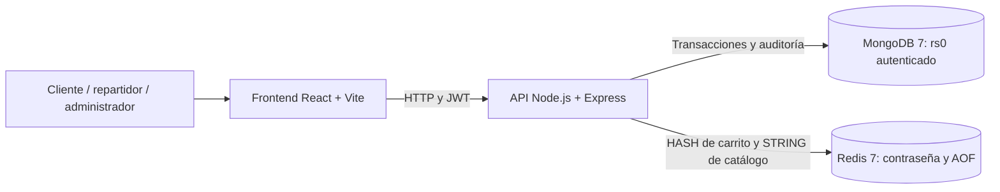
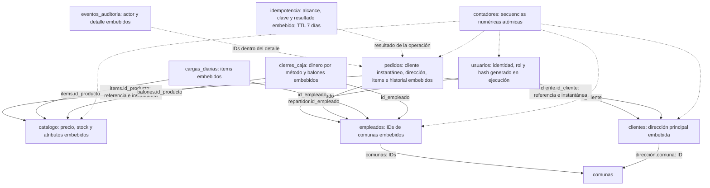

# Arquitectura y modelo

Las referencias son IDs numéricos, no claves foráneas. Las instantáneas conservan
nombre, precio y dirección aunque los documentos de origen cambien. Cada carga y
cierre es único por fecha y empleado. Los once esquemas e índices están en
`db/mongo/init.js`. Los carritos no son una colección MongoDB.
